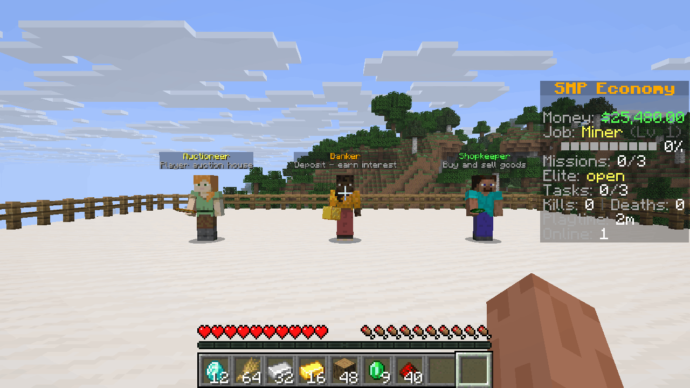
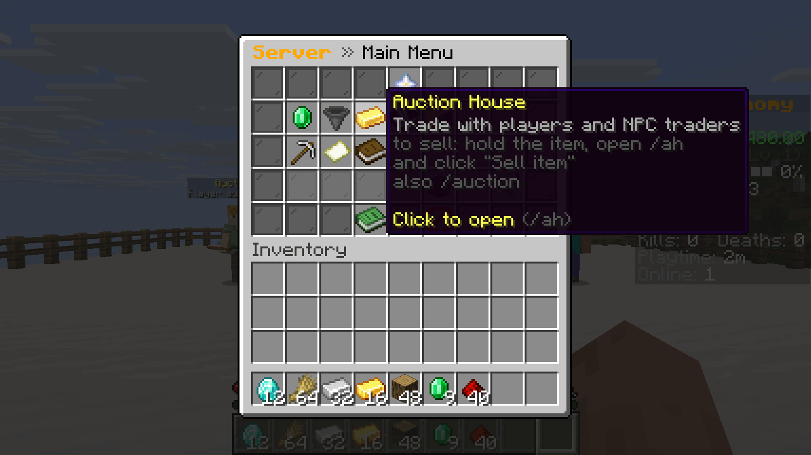
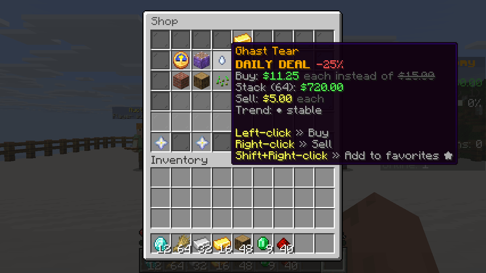
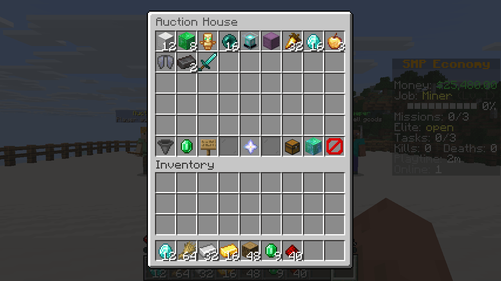
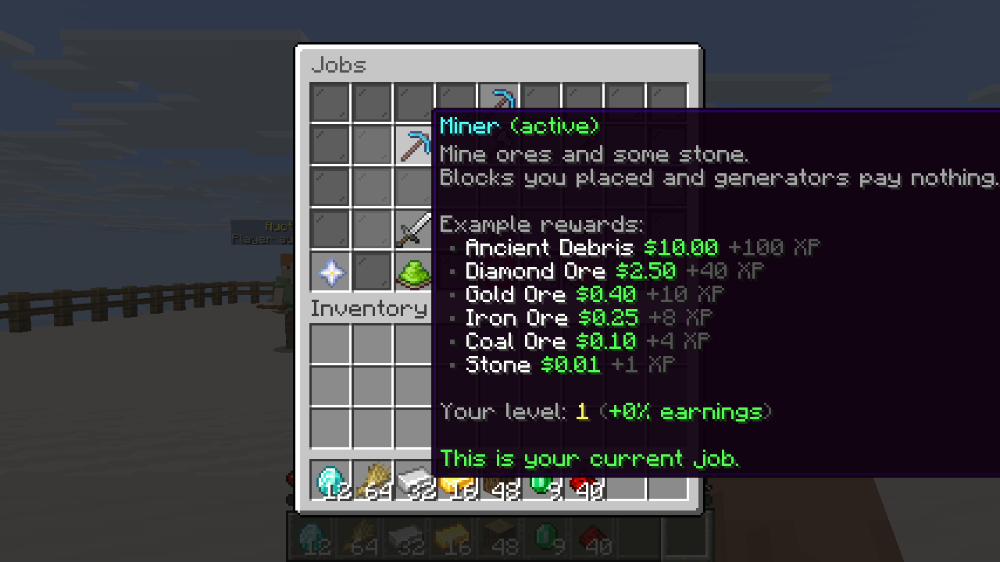
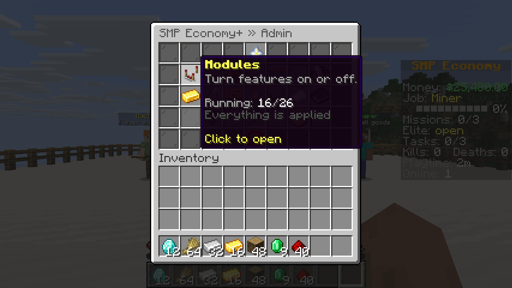
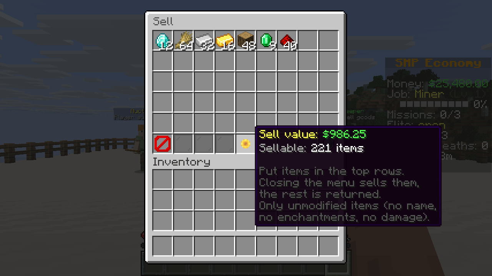

<div align="center">


# SMP Economy+

A server-side economy mod for Fabric SMP servers. Players join with a vanilla client.

[](https://modrinth.com/mod/smp-economy-plus)
[](LICENSE)
[](#install)

[Install](#install) · [Modules](#modules) · [Money](#how-the-money-works) · [Admin](#admin) · [Works with](#works-with) · [Commands](docs/commands.md) · [Config](docs/configuration.md) · [Website](https://levi-smokrovic.github.io/smp-economy-plus/)



</div>

I built this for my own server and wanted everything in one jar: money, jobs, a shop, an auction house and a sidebar, with nothing for players to install. Menus are chest GUIs, the sidebar is the vanilla scoreboard, and NPCs are vanilla entities.

| Main menu | Shop with a daily deal |
|---|---|
|  |  |
| **Auction house** | **Jobs** |
|  |  |
| **Admin menu** | **Sell GUI** |
|  |  |

These are unedited shots from a 1.21.11 test server. I set up the platform, the NPCs, the money and the auction listings for the pictures, so the listings are NPC listings and not real player trades.

## Install

1. Run a Fabric server on one of the versions below.
2. Put Fabric API and the SMP Economy+ jar for your Minecraft version into `mods/`.
3. Start the server, join as an operator and run `/smpeco admin`.

| Minecraft | Java | Fabric Loader | Built against Fabric API |
|---|---|---|---|
| 1.21.11 | 21+ | 0.19.5+ | 0.141.6 |
| 26.1.2 | 25+ | 0.18.4+ | 0.155.3 |
| 26.2 | 25+ | 0.18.4+ | 0.161.0 |
| 26.3 | 25+ | 0.19.3+ | 0.165.0 |

sgui, fabric-permissions-api and Common Economy API are inside the jar. LuckPerms is optional. See [Works with](#works-with) for other mods.

## Modules

Each module can be switched on or off in `/smpeco admin`, with `/smpeco module enable <id>`, or in `config/smpeconomy/modules.json`. A change needs a server restart. A module that is off registers no commands and creates no config or data files of its own (`prices.json` and `shop.json` belong to the core).

### On by default

| Id | What it does | Commands |
|---|---|---|
| `economy` | Balances, payments and the server treasury. Can't be turned off. | `/bal`, `/pay`, `/baltop`, `/paytoggle`, `/treasury`, `/eco` |
| `starter` | A starter kit you capture from your own inventory | `/smpeco starterkit` |
| `sell` | Sell GUI, with prices in `prices.json` | `/sell`, `/worth` |
| `shop` | Categories, search, favourites and daily deals | `/shop` |
| `auction` | Player auction house | `/ah` |
| `orders` | Buy orders from players and NPC traders | `/orders` |
| `jobs` | Miner, lumberjack, farmer, hunter, fisher and digger, up to level 50 | `/jobs` |
| `tasks` | Three daily tasks and a bonus for finishing all of them | `/tasks` |
| `missions` | Mission board with four tiers and one elite mission a day | `/missions` |
| `bank` | Separate bank balance with daily interest | `/bank` |
| `hud` | Sidebar and tab list | `/sidebar` |
| `settings` | Per-player toggles | `/settings` |
| `stats` | Stats and leaderboards | `/stats`, `/playtime`, `/leaderboard` |
| `holo` | Leaderboard holograms you place yourself | `/holo` |
| `menu` | Main menu and command help | `/menu`, `/commands` |
| `npc` | NPCs that open a module menu or run a command. None exist until you create one. | `/smpeco npc` |

### Off by default

| Id | What it does | Commands |
|---|---|---|
| `casino` | Blackjack, roulette, slots, crash, plinko, dice, wheel, horse race, scratch cards, mines and hi-lo, with a daily loss limit per player | `/casino`, `/blackjack`, `/slots` and others |
| `minigames` | Chat games, the MEGA challenge, treasure hunts and player coinflips | `/chatgame`, `/coinflip`, `/treasure` |
| `events` | Lottery, market day, gold rush, lucky hour and trader ranks | `/lottery`, `/event`, `/rank` |
| `clans` | Invites, ranks, clan bank, clan home and clan chat | `/clan`, `/cc` |
| `bounty` | Put money on another player | `/bounty` |
| `crates` | Virtual keys and an animated spin. Other modules only reward keys while this one is on. | `/crates` |
| `daily` | Login streak rewards | `/daily` |
| `afk` | A zone that pays players for standing in it | `/afkzone` |
| `market` | Moving market values and NPC buyers and sellers in the auction house. Needs `auction`. | `/market` |
| `news` | Random events that move prices for a while, plus flash sales | `/news` |

Every command and permission is listed in [docs/commands.md](docs/commands.md). Every config file is in [docs/configuration.md](docs/configuration.md).

## How the money works

All amounts are stored in cents. Players can type `2.5k` or `1m` for amounts.

The treasury starts with $25,000. It collects a share of shop purchases, auction tax and casino losses. It pays for NPC buyers and bank interest, and that spending is capped at 5% of its balance per rolling hour. `/sell` and job pay are not paid by the treasury, so they add new money to the server. If prices drift too high, lower `multipliers.sell` and `multipliers.jobPay` in `core.json`.

Jobs pay 2% more per level. Placed blocks, unripe or bone-mealed crops and creative mode don't pay. Spawner mobs pay 25%, and spawn-egg, bred and summoned mobs pay nothing. Veinminer and Tree Harvester pay per block. See [Works with](#works-with).

Bank interest is 1% a day on money held for at least 24 hours, capped at $2,000 per player per day.

## Admin

`/smpeco admin` needs `smpeconomy.admin.core` and `smpeconomy.admin`. It covers modules, start money, the currency symbol and names, the sell and job-pay multipliers, the chat prefix, the sidebar title, the starter kit, NPC visibility and config reload.

Without a permission plugin, player commands are open to everyone and admin commands need OP level 2. Console and RCON can run everything. LuckPerms works through fabric-permissions-api.

New players start with $0 unless you change `startBalance`. The starter kit only goes to players with under 5 minutes of playtime, so installing on an old world won't hand kits to everybody.

The daily reset uses the server machine's time zone. Set `timezone` in `core.json` to change it.

## Your data

Configs are in `config/smpeconomy/`. Player and economy data is JSON in `<world>/smpeconomy/`.

Mod data is saved with a journal right before vanilla saves players and the world, and when a player disconnects. After a crash, money, items and the world go back to the last save together. One gap: when a player disconnects, mod data and other players' files with pending item moves are written too, so until the next autosave those can be newer than the world. A restore point is written after each successful start and the latest five are kept.

If a data file is damaged at startup, or missing although it existed before, the server refuses to start and logs what to do. I chose that on purpose: restoring one old file alone would duplicate money or items. Either repair the file, or place a `RESTORE_ALLOWED` file in `<world>/smpeconomy/` to reset all mod data to the same restore point. When you restore a server backup, restore the world and `smpeconomy` together.

## Known limitations

- In-game text is in English and hardcoded. There are no translation files.
- Going back to an older Minecraft version with the same data is not supported.
- 21 enchanted-book trades from the `trade_rebalance` datapack aren't checked on 26.x because their enchantment tags exist only in that datapack. 1.21.11 skips these books too. Explorer maps are also skipped on 26.x. These only affect the trade-based price checks.
- When the mod refuses to start because `economy.json` is damaged, or missing although it existed before, an RCON command arriving at that moment can block shutdown until the watchdog kills the server after 60 seconds. The start is still refused and the data files stay unchanged. I saw this in 1 of 4 refused starts on 1.21.11.

## Works with

Nothing here is required, and without the other mod nothing changes. I tested these on dedicated test servers with bots, on all four Minecraft versions unless noted.

| Mod | What happens |
|---|---|
| Veinminer | Every block of a vein pays on its own. Claims are asked for every block, also with older Veinminer versions that skip the break event for follow-up blocks. |
| Flan, Open Parties and Claims | Breaks they deny pay nothing. A vein that crosses a claim border stops at the border and pays for the blocks outside. I ran the vein test on all four versions with Flan, and on 1.21.11 and 26.1.2 with Open Parties and Claims. |
| Tree Harvester | Every log of a felled tree pays. Placed logs pay nothing. |
| RightClickHarvest | Harvests pay. Harvests Flan denies pay nothing. |
| Universal Shops (tested on 1.21.11 and 26.3) | Sells for player money through Common Economy API, which is inside our jar. One raw unit is one cent. The bank and the treasury are not exposed. |
| Styled Chat (placeholders tested on 1.21.11 and 26.3) | Can show the placeholders below. Clan chat stays private. |
| Styled Player List | Keeps the tab list, because it resends its own header and footer every second. Put the placeholders below in its style files to show our data there. Set `tablistWithStyledPlayerList` in `hud.json` to send ours anyway. |
| Vanish | The sidebar and tab footer count of online players leaves out vanished players for anyone who can't see them. |
| Carpet | `/player` bots get no job pay, account or start money, and stay off `/baltop`. Set `botsEarn` in `jobs.json` to let them earn job pay; a bot that earns gets an account and then shows up on `/baltop`. Tasks, missions and other rewards also skip bots in the code, but I only ran the cases above with a real bot. |
| Universal Graves | Graves work. Dying with items in the sell GUI sells them once. |
| Polymer | Modded items can be priced like vanilla ones (tested on 1.21.11 and 26.3, with Universal Shops items). |
| LuckPerms, Ledger, Lithium, FerriteCore, C2ME, Krypton, ServerCore, Spark, Chunky, BlueMap, Essential Commands (no 26.1.2 build), Dynmap (1.21.11 only) | No conflict found. |

### Placeholders

With [Placeholder API](https://modrinth.com/mod/placeholder-api), which Styled Chat and Styled Player List bring along: `%smpeconomy:balance%`, `%smpeconomy:balance_short%`, `%smpeconomy:bank%`, `%smpeconomy:job%`, `%smpeconomy:job_level%`, `%smpeconomy:currency%`.

### Items from other mods

Add their ids to `prices.json`, `shop.json`, `market.json` or `orders.json`. An id nothing has registered, for example after removing a mod, is skipped with one warning per file. `crates.json`, the mission files and the treasure hunt loot are stricter: an unknown id makes the file invalid and the last good version stays active.

### Command names

If two mods register the same command, Brigadier merges them into something neither mod intended. So when another mod has already registered a name such as `/shop` or `/pay` by the time SMP Economy+ adds its commands, SMP Economy+ leaves it alone and logs a warning. The warning names the mod when it can tell which one it is. To take a command back under another name, or to drop one, edit `config/smpeconomy/commands.json`:

```json
{
  "disabled": ["pay", "paytoggle"],
  "renamed": { "shop": "market", "ah": "auctions" }
}
```

An alias is its own root, so renaming `balance` leaves `/bal` and `/money` as they are. Changes apply on restart or `/reload`. GUI buttons, click events and NPCs follow the new name. `/smpeco` can be renamed but not disabled. To turn a whole feature off, use `modules.json`.

### Known conflicts

- Burger Economy has no Common Economy API support, so both economies run side by side. Names it registers first, such as `/balance`, `/pay`, `/baltop`, `/eco` and `/ah`, stay with it until you rename ours.
- With Vanish, `/bal <name>`, `/pay <name>` and `/baltop` still find a vanished player, and Styled Player List's own `%server:online%` still counts them.
- With Veinminer 2.11 and older, a follow-up block that a claim denies still costs tool durability and hunger, because Veinminer applies those itself. I read this from its code and didn't measure it.
- Tree Harvester 9.3 on 1.21.11 doesn't ask claims about logs beyond the first one, and those logs pay. I didn't test a tree across a claim border.
- Chat hints that mention a command keep its default name after a rename.
- A mod that registers commands in a later Fabric event phase than ours still merges into our node. Brigadier gives no way to detect that.
- The self tests refuse to run while Ledger is installed: their test players make Ledger's database queue fail and retry until `/stop` hangs.

## Building

```sh
tools/build-all.sh
```

This needs JDK 25, even for the 1.21.11 jar, and writes four jars to `build/release/`. The project uses Stonecutter, so one source tree builds all versions.

## Testing

The self tests need a real running server, because they exercise vanilla items, recipes and commands. That's why they live in `src/main` and ship in the jar. They only exist when the server starts with `-Dsmpeconomy.selftest=true`, and `/smpeco selftest` runs them. A run blocks the server thread and changes data, so don't use the flag on a live server. It refuses to run with Ledger installed.

End-to-end tests drive a throwaway server with bots. See [e2e/README.md](e2e/README.md).

## License and credits

Made by Levi (12iveL). Originally built for the 12tri SMP. Source: <https://github.com/Levi-Smokrovic/smp-economy-plus>

SMP Economy+ is under the [MIT license](LICENSE). You can use it in modpacks and forks. Please credit "SMP Economy+ by Levi (12iveL)" and link back here.

The jar bundles [sgui](https://github.com/Patbox/sgui) by Patbox (LGPL-3.0), [fabric-permissions-api](https://github.com/lucko/fabric-permissions-api) by lucko (MIT) and [Common Economy API](https://github.com/Patbox/common-economy-api) by Patbox (Apache-2.0). See [THIRD_PARTY_NOTICES.md](THIRD_PARTY_NOTICES.md).
