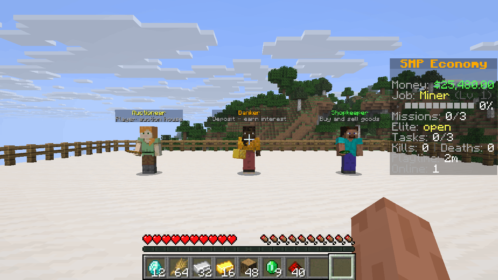
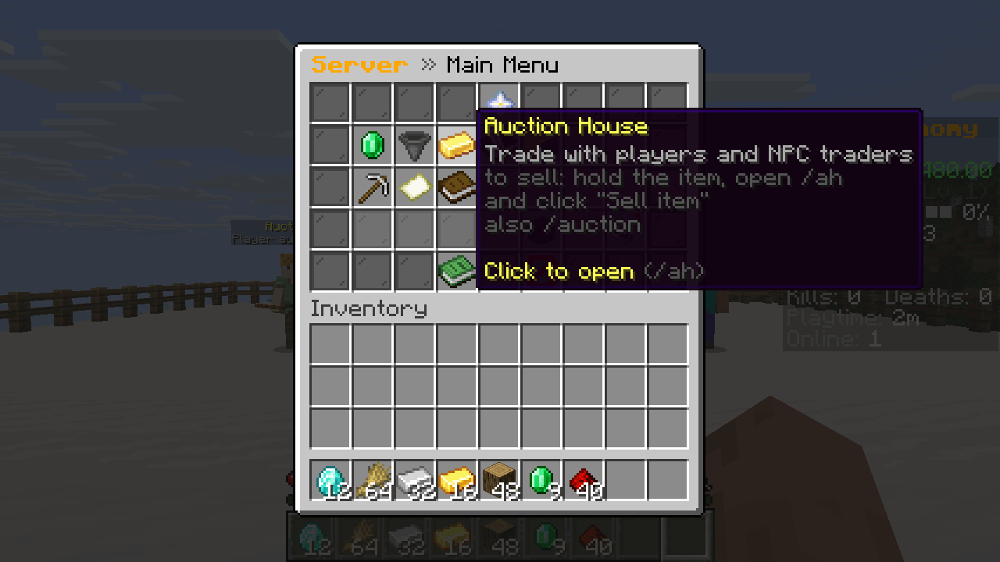
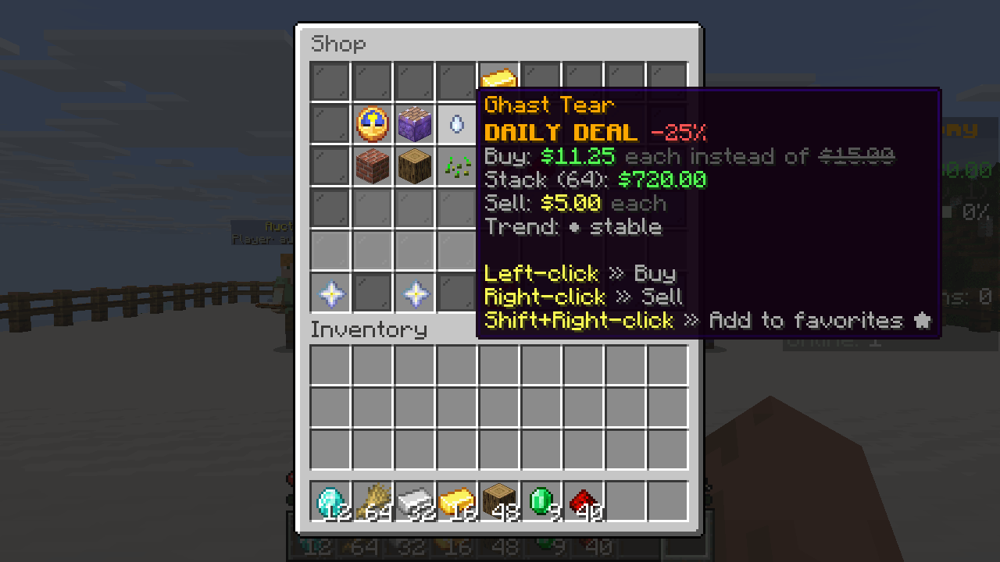
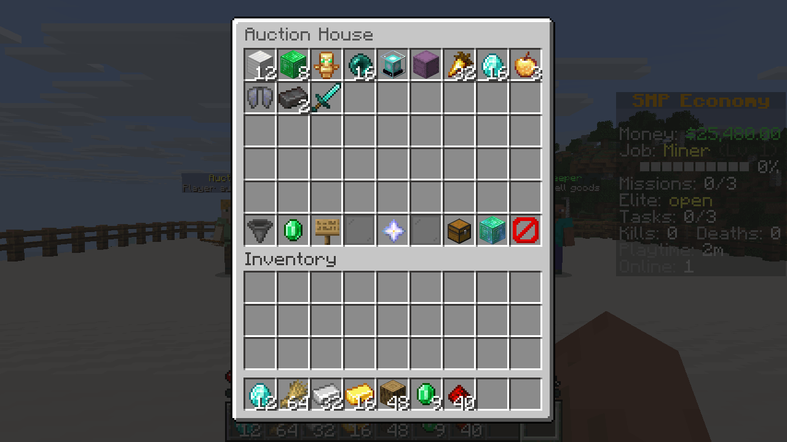
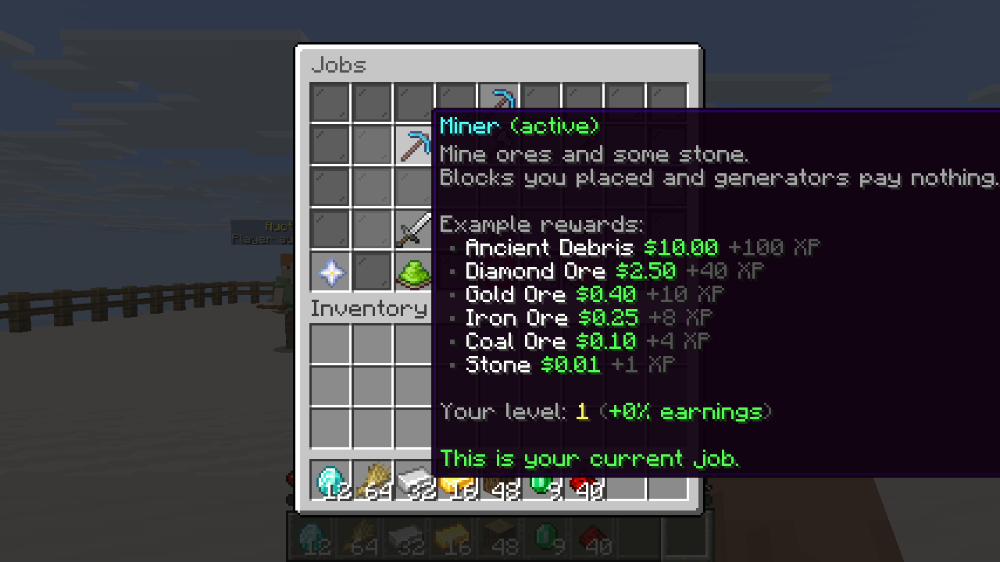
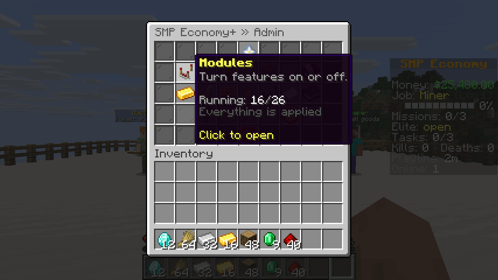
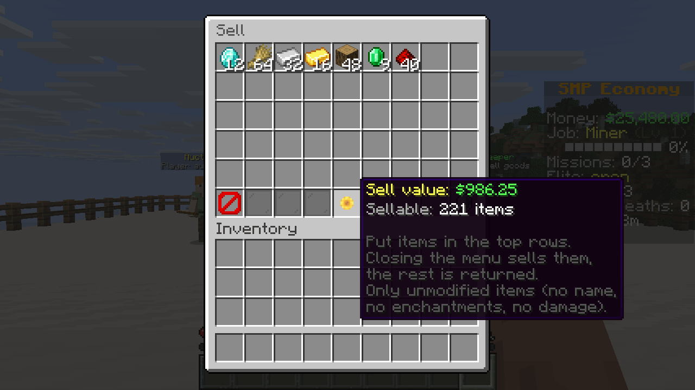

A full economy for Fabric SMP servers in one jar: money, a shop, an auction house, jobs, a bank and a sidebar. It runs only on the server, and players join with a vanilla client.

I made it for the server I play on. Menus are chest GUIs, the sidebar is the vanilla scoreboard, and NPCs are vanilla entities, so there is nothing for your players to install.

| Main menu | Shop with a daily deal |
|---|---|
|  |  |
| **Auction house** | **Jobs** |
|  |  |
| **Admin menu** | **Sell GUI** |
|  |  |

These are unedited shots from a 1.21.11 test server. I set up the platform, the NPCs, the money and the auction listings for the pictures, so the listings are NPC listings and not real player trades.

## Modules

There are 26 modules, and you can switch each one on or off. A module that is off registers no commands and creates no config or data files of its own (`prices.json` and `shop.json` belong to the core).

These 16 are on after install:

| Module | What players get |
|---|---|
| Economy | Balances, `/pay`, `/baltop` and a server treasury. This one can't be turned off. |
| Sell | A `/sell` GUI and `/worth`, with prices in a config file |
| Shop | `/shop` with categories, search, favourites and daily deals |
| Auction house | `/ah` for player listings |
| Orders | `/orders` for buy orders from players and NPC traders |
| Jobs | Miner, lumberjack, farmer, hunter, fisher and digger, up to level 50, with 2% more pay per level |
| Daily tasks | Three tasks a day and a bonus for finishing all of them |
| Missions | A mission board with four tiers and one elite mission a day |
| Bank | A separate balance with 1% daily interest, capped at $2,000 per player per day |
| Sidebar | Balance, job, tasks and more on the vanilla scoreboard, plus the tab list |
| Settings | Per-player toggles in `/settings` |
| Stats | `/stats`, `/playtime` and `/leaderboard` |
| Holograms | Leaderboard holograms you place yourself |
| Menu | `/menu` and `/commands` |
| Starter | Start money and a starter kit for new players |
| NPCs | NPCs that open a module menu or run a command. None exist until you create one. |

These 10 stay off until you turn them on:

| Module | What it adds |
|---|---|
| Casino | Blackjack, roulette, slots, crash, plinko, dice, wheel, horse race, scratch cards, mines and hi-lo, with a daily loss limit per player |
| Minigames | Chat games, the MEGA challenge, treasure hunts and player coinflips |
| Lottery and events | Lottery, market day, gold rush, lucky hour and trader ranks |
| Clans | Invites, ranks, clan bank, clan home and clan chat |
| Bounties | Put money on another player |
| Crates | Virtual keys and an animated spin |
| Daily rewards | Login streaks |
| AFK zone | Pays players for standing in an area you set |
| Market | Moving values and NPC buyers and sellers in the auction house. Needs the auction module. |
| Breaking news | Random events that move prices for a while, plus flash sales |

Jobs ignore the usual farming tricks. Placed blocks, unripe or bone-mealed crops and creative mode don't pay. Spawner mobs pay 25%, and spawn-egg, bred and summoned mobs pay nothing.

## What you do first

1. Put Fabric API and the jar for your Minecraft version into `mods/`, then start the server.
2. Join as an operator and run `/smpeco admin`. Turn on the extras you want and restart, because module changes need a restart.
3. Set the start money, which is $0 by default. New players with under 5 minutes of playtime get a small kit (stone tools and bread). Run `/smpeco starterkit capture` to replace it with your own inventory.
4. Set your sidebar title, chat prefix and currency in the same menu.
5. Place NPCs with `/smpeco npc create` and holograms with `/holo create` if you want them.
6. If you use a permission plugin, give your admins `smpeconomy.admin.core` and `smpeconomy.admin`. Without one, player commands are open to everyone and admin commands need OP level 2.

`/sell` and job pay add new money to the server, so watch your prices. If they drift too high, lower the sell and job-pay multipliers in the admin menu.

The daily reset follows the server machine's time zone. Set `timezone` in `core.json` to change it.

## Requirements

| Minecraft | Java | Fabric Loader |
|---|---|---|
| 1.21.11 | 21+ | 0.19.5+ |
| 26.1.2 | 25+ | 0.18.4+ |
| 26.2 | 25+ | 0.18.4+ |
| 26.3 | 25+ | 0.19.3+ |

Fabric API is required on the server, and each Minecraft version has its own jar. Clients need nothing. sgui, fabric-permissions-api and Common Economy API are inside the jar.

## Works with

Everything here is optional. I only list what I ran on dedicated test servers with bots, on all four Minecraft versions unless noted.

| Mod | What happens |
|---|---|
| [VeinMiner](https://modrinth.com/mod/veinminer) | Every block of a vein pays on its own, and claims are asked about every block |
| [Flan](https://modrinth.com/mod/flan), [Open Parties and Claims](https://modrinth.com/mod/open-parties-and-claims) | Breaks they deny pay nothing. A vein that crosses a claim border stops there and pays for the blocks outside. I ran the vein test on all four versions with Flan, and on 1.21.11 and 26.1.2 with Open Parties and Claims. |
| [Tree Harvester](https://modrinth.com/mod/tree-harvester) | Every log of a felled tree pays, and placed logs pay nothing |
| [RightClickHarvest](https://modrinth.com/mod/rightclickharvest) | Harvests pay, and harvests Flan denies pay nothing |
| [Universal Shops](https://modrinth.com/mod/universal-shops) (1.21.11 and 26.3) | Sells for player money through the bundled Common Economy API. The bank and the treasury are not exposed. |
| [Styled Chat](https://modrinth.com/mod/styled-chat) (placeholders on 1.21.11 and 26.3) | Can show our placeholders, and clan chat stays private |
| [Styled Player List](https://modrinth.com/mod/styledplayerlist) | Keeps the tab list, and you can put our placeholders in its style files. Set `tablistWithStyledPlayerList` in `hud.json` to send ours anyway. |
| [Vanish](https://modrinth.com/mod/vanish) | The online count in the sidebar and tab footer leaves out vanished players for anyone who can't see them |
| [Carpet](https://modrinth.com/mod/carpet) | `/player` bots get no job pay, account or start money, and stay off `/baltop`, unless you set `botsEarn` in `jobs.json` |
| [Universal Graves](https://modrinth.com/mod/universal-graves) | Graves work, and dying with items in the sell GUI sells them once |
| [Polymer](https://modrinth.com/mod/polymer) (1.21.11 and 26.3, with Universal Shops items) | Modded items can be priced like vanilla ones |

I also found no conflict with [LuckPerms](https://modrinth.com/mod/luckperms), [Ledger](https://modrinth.com/mod/ledger), [Lithium](https://modrinth.com/mod/lithium), [FerriteCore](https://modrinth.com/mod/ferrite-core), [C2ME](https://modrinth.com/mod/c2me-fabric), [Krypton](https://modrinth.com/mod/krypton), [ServerCore](https://modrinth.com/mod/servercore), [Spark](https://modrinth.com/mod/spark), [Chunky](https://modrinth.com/mod/chunky), [BlueMap](https://modrinth.com/mod/bluemap), [Essential Commands](https://modrinth.com/mod/essential-commands) (no 26.1.2 build) and [Dynmap](https://modrinth.com/mod/dynmap) (1.21.11 only).

With [Placeholder API](https://modrinth.com/mod/placeholder-api), which Styled Chat and Styled Player List bring along, you get `%smpeconomy:balance%`, `%smpeconomy:balance_short%`, `%smpeconomy:bank%`, `%smpeconomy:job%`, `%smpeconomy:job_level%` and `%smpeconomy:currency%`.

If another mod has already registered a command such as `/shop` or `/pay` by the time SMP Economy+ adds its commands, SMP Economy+ leaves it alone and logs a warning. The warning names the mod when it can tell which one it is. You can take the command back under another name in `commands.json`.

The conflicts I know about are [listed in the README](https://github.com/Levi-Smokrovic/smp-economy-plus#known-conflicts).

## Config

Everything lives in `config/smpeconomy/` as JSON. Each module has its own files, and `core.json`, `modules.json` and `commands.json` cover the rest. `/smpeco reload` applies your edits, except `modules.json` and `quiz_items.json`, which need a restart, and `commands.json`, which needs a restart or vanilla `/reload`. A broken edit never overwrites the file, and the last good version stays active.

Items from other mods work too. Add their ids to `prices.json`, `shop.json`, `market.json` or `orders.json`.

The [command and permission list](https://github.com/Levi-Smokrovic/smp-economy-plus/blob/main/docs/commands.md) and the [config reference](https://github.com/Levi-Smokrovic/smp-economy-plus/blob/main/docs/configuration.md) are on GitHub.

## Your data

Player and economy data is JSON in `<world>/smpeconomy/`. It's saved at the same moments vanilla saves players and the world, using a journal, and a restore point is written after each successful start.

If a data file is damaged at startup, or missing although it existed before, the server refuses to start and logs what to do. I chose that on purpose, because restoring one old file alone would duplicate money or items.

## Known limitations

In-game text is English only, with no translation files. Going back to an older Minecraft version with the same data isn't supported. The full list is in the [README](https://github.com/Levi-Smokrovic/smp-economy-plus#known-limitations).

## Source and license

The source is on [GitHub](https://github.com/Levi-Smokrovic/smp-economy-plus), under the MIT license, and the project has a [website](https://smp-economy-plus.pages.dev/). You can use it in modpacks and forks. Please credit "SMP Economy+ by Levi (12iveL)" and link this page.

The jar bundles [sgui](https://github.com/Patbox/sgui) by Patbox (LGPL-3.0), [fabric-permissions-api](https://github.com/lucko/fabric-permissions-api) by lucko (MIT) and [Common Economy API](https://github.com/Patbox/common-economy-api) by Patbox (Apache-2.0).
